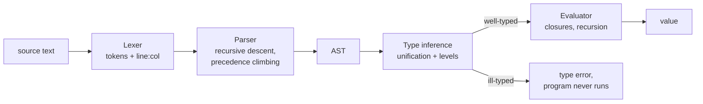

# mini-ml

A small ML-family language implemented in OCaml from scratch: a lexer, a recursive-descent
parser, **Hindley–Milner type inference with let-polymorphism**, and an environment-based
evaluator. Programs need no type annotations; every type is inferred, and ill-typed programs are
rejected before they run.

```ocaml
(* examples/lists.mml *)
let rec map f xs = match xs with [] -> [] | x :: rest -> f x :: map f rest;;
let rec filter p xs = match xs with [] -> [] | x :: rest -> if p x then x :: filter p rest else filter p rest;;
let rec fold f acc xs = match xs with [] -> acc | x :: rest -> fold f (f acc x) rest;;
let rec range a b = if a > b then [] else a :: range (a + 1) b;;
let sum = fold (fun acc x -> acc + x) 0;;
let is_prime n =
  let rec check d = if d * d > n then true else if n mod d = 0 then false else check (d + 1) in
  n > 1 && check 2;;
(sum (map (fun x -> x * x) (range 1 10)), filter is_prime (range 1 50))
```

```
$ dune exec bin/main.exe -- examples/lists.mml
- : int * int list = (385, [2; 3; 5; 7; 11; 13; 17; 19; 23; 29; 31; 37; 41; 43; 47])

$ dune exec bin/main.exe -- -e "fun f g x -> f (g x)"
- : ('a -> 'b) -> ('c -> 'a) -> 'c -> 'b = <fun>

$ dune exec bin/main.exe -- examples/type_error.mml
type error: cannot unify int with bool
```

## Pipeline



## The language

Integers, booleans, unit, pairs and lists; `fun`, application, `let` and `let rec`, `if`,
`match` on lists, `+ - * / mod`, comparisons, `= <>`, `&& ||` (short-circuit) and `::`. The
built-ins are `fst`, `snd` and `not`. Top-level definitions end in `;;`, and `(* comments *)` nest.

## How type inference works

Each sub-expression gets a type, possibly a fresh unknown `'t`. Constraints such as "the function's
argument type equals the argument's type" are solved on the fly by **unification**: union-find over
type variables, with an occurs check that rejects infinite types like `'a = 'a -> 'b`.

**Let-polymorphism with levels.** `let id = fun x -> x in (id 1, id true)` is well-typed because
`id` is generalised to `∀a. a -> a`, and each use gets a fresh copy. Every type variable remembers
the let-nesting depth (level) at which it was created. On leaving a `let`, variables still deeper
than the current level belong only to that definition and can be quantified. Unification lowers
levels when variables escape outward. This avoids rescanning the whole environment at every `let`,
and it is how OCaml's own type checker works.

Lambda-bound variables are *not* generalised, which is why `fun f -> (f 1, f true)` is rejected.
Since the language has no mutable references, generalising every `let` is sound with no value
restriction.

## Tests

31 checks in `test/test_miniml.ml`:

- **Principal types**, for example `map : ('a -> 'b) -> 'a list -> 'b list`,
  `fold : ('a -> 'b -> 'a) -> 'a -> 'b list -> 'a`, composition and pair swapping.
- **Let-polymorphism**, and its absence for lambda-bound variables.
- **Rejections**: occurs check (`fun x -> x x`), `1 + true`, non-bool conditions, mixed lists and unbound variables.
- **Evaluation**: factorial, Fibonacci, map, filter, ranges with 1,000 elements, structural equality,
  nested comments and top-level `;;` programs.
- **Errors carry positions**, for example `syntax error at line 1, column 9`, along with runtime
  errors for division by zero and comparing functions.

One bug the tests caught: the type printer named variables in reverse order. OCaml evaluates the
operands of `^` right-to-left, so `go a ^ " -> " ^ go b` visited the right side first. The fix is
explicit `let` sequencing in `Types.to_string`.

## Build

```bash
opam install dune
dune build && dune test
dune exec bin/main.exe -- examples/lists.mml      # or -e "expr", or read stdin
```

CI runs on OCaml 4.14 and 5.2.

## Possible extensions

User-defined algebraic data types with general pattern matching; references, which would require
the value restriction; and a bytecode compiler in place of the tree-walking evaluator.

## References

- R. Milner, *A theory of type polymorphism in programming*, J. Comput. Syst. Sci. 17, 348–375 (1978).
- L. Damas & R. Milner, *Principal type-schemes for functional programs*, POPL (1982).
- D. Rémy, *Extension of ML type system with a sorted equational theory on types*, INRIA Research Report 1766 (1992). This is the origin of level-based generalisation.

## License

MIT
